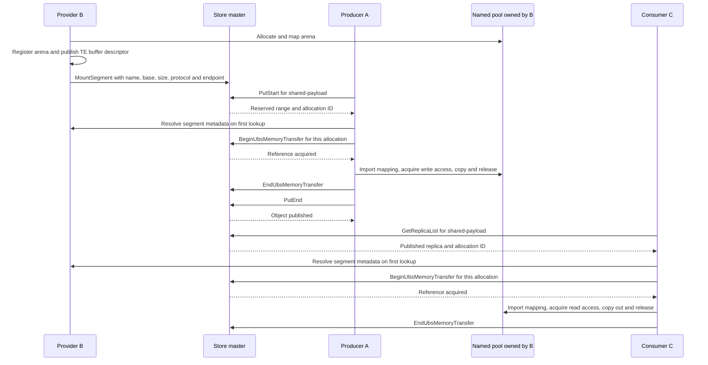

# Mooncake CPU UBS Memory transport design

**Implementation status · 3 November 2026.** The Linux mock runs a complete
Mooncake Store Put/Get across three client processes. The SDK adapter has
been syntax-checked. Hardware ownership, cache visibility and performance
still require validation on a UB system.

Producer A calls `Put("shared-payload", data)`. Mooncake assigns space in a
pool owned by Provider B. A maps that pool into its own process and writes
the bytes. Later, Consumer C calls Get and reads the same bytes through C's
own mapping. Applications keep the existing Store APIs. A Put copies into
the pool and a Get copies out into a caller-owned buffer.

## Processes and communication

| Component | Owns | What it does for one object |
| --- | --- | --- |
| Master | Store key and replica metadata, free ranges, allocation IDs and active transfer references | Chooses a range on Put, publishes the completed replica, answers Get queries and decides when a deleted range can be reused. |
| Provider B | A named UBS arena, B's local mapping and a Store client | Creates the pool, registers it with its Transfer Engine and mounts it with the master. Keeps it alive while A and C use it. |
| Producer A | Input staging memory, a Store client and its Transfer Engine worker | Obtains a write descriptor and a transfer reference, then writes through A's mapping of B's pool. |
| Consumer C | Output staging memory, a Store client and its Transfer Engine worker | Looks up the published replica, obtains a reference and reads through C's mapping. |

The lab uses TCP RPC for Store operations and the P2P handshake for Transfer
Engine segment metadata. Payload bytes travel through the shared mapping.
The master never receives those bytes. B's application can be asleep while
A writes and C reads. Each client runs its own Transfer Engine.



The diagram shows the successful single-object path. Segment metadata can be
cached. The client must hold the master reference before submitting the copy.
A failed Put goes through the Store's
revoke path instead of publishing a readable replica. [Store client](../mooncake-store/src/client_service.cpp) · [Transfer submission](../mooncake-store/src/transfer_task.cpp)

## Startup and memory allocation

1. **Select and install the engine transport.** Store passes the selected
   protocol to the classic Transfer Engine. With `ubsmem` selected,
   `TransferEngineImpl::init()` asks `MultiTransport` to construct and install
   one `UbsMemoryTransport`. Installation publishes the local segment
   descriptor and starts the worker. After successful initialization,
   `getTransport("ubsmem")` returns it. The engine rejects a conflicting
   `MC_FORCE_TCP` selection. [Engine initialization](src/transfer_engine_impl.cpp) · [Transport factory](src/multi_transport.cpp)
2. **Allocate local staging.** Each client may create an ordinary CPU buffer.
   Store registers it with `remote_accessible=false`. In the demo each role
   has 4 MiB of staging. This is the buffer you see when stepping through
   `ClientBufferAllocator::create()`. [RealClient setup](../mooncake-store/src/real_client.cpp)
3. **Allocate the shared arena.** B also passes a nonzero `global_segment_size`
   (4 MiB in the demo). `UbsMemoryArena::create()` rounds the arena size up
   to a 4 MiB multiple and calls the selected backend. A and C pass zero and
   import B's arena on demand. B keeps its arena handle for the pool's
   lifetime. [Arena creation and import](src/transport/ubsmem_transport/ubsmem_memory.cpp)
4. **Register and mount.** B registers the arena as remotely accessible, then
   sends `MountSegment` to the master. The master creates a
   `UbsMemoryBufferAllocator` over the published range. Later Puts reserve
   **subranges** of that arena. B does not create a new named backing object
   for every key. [Segment manager](../mooncake-store/src/segment.cpp) · [Pool allocator](../mooncake-store/include/ubsmem_allocator.h)

**Segment name and port.** In the classic P2P Store setup, a `ubsmem` client
given only a hostname and an explicit `MC_TE_HANDSHAKE_PORT` uses that port
when forming its segment name. Other protocols keep the existing automatic
port selection. In the lab B both listens and mounts as
`127.0.0.1:16002`. An explicitly supplied logical `host:port` is preserved.
The master RPC address is separate. You can inspect the names actually
mounted with `curl http://127.0.0.1:9013/get_all_segments` inside the
container. [Name selection](../mooncake-store/src/real_client.cpp) · [Master endpoint](../mooncake-store/src/master_admin_service.cpp)

## Descriptors and address translation

| Identifier | What it identifies | Lifetime |
| --- | --- | --- |
| Segment name and Transfer Engine endpoint | The mounted Store pool and the endpoint that supplies its buffer metadata | Client session |
| UBS object name and generation | A particular backing arena, with a backend, domain, host identity, object size and registered buffer's offset | Arena lifetime |
| Store allocation ID | One reservation within the arena, with provider address, requested size, protocol and endpoint | Until retired. A later reservation gets a new ID. |
| Client UUID and operation ID | One Begin/End reference held by a transfer | Until End. Completed IDs are remembered to handle retries. |

A provider address is a coordinate in B's address space. The other process
must translate it. `UbsMemoryTransport::prepare()` checks the opcode, the
whole staging range, the target segment protocol, the advertised buffer
bounds and the UBS descriptor. It resolves or imports the mapping and
retains the staging registration and arena for the worker.
[Descriptor fields](include/transport/ubsmem_transport/ubsmem_descriptor.h) · [Request preparation](src/transport/ubsmem_transport/ubsmem_transport.cpp)

```text
offset within published buffer = request.target_offset - buffer.addr
offset within arena            = buffer.ubsmem.object_offset + offset within published buffer
address used by A or C         = local mapped arena base + offset within arena
```

For example, if B publishes its whole arena and A gets an address 128 bytes
past B's base, A writes 128 bytes past **A's** mapped base. On a READ,
`request.source` names C's local staging buffer even though the copy writes
into it. Inspect the mapped bytes in CLion only after the worker acquires
access. [Guarded copy](src/transport/ubsmem_transport/ubsmem_memory.cpp)

## Transfer execution, deletion and reuse

The submitting thread prepares work and enqueues it. One worker per transport
acquires arena access, copies the slice and releases access before reporting
success. Queue capacity is 256 pending requests. When the queue is full,
submission waits for space instead of failing, so a large Store batch is
throttled rather than rejected. The default queue and lock deadline is
30 seconds; a request that cannot enter the queue before its deadline fails. Staging memory must live
through completion. Store disables its ordinary local memcpy shortcut for
UBSMEM, including B's Put/Get against its own pool. Self-targeted transfers
must take the same ownership lock as remote ones.

**Two mechanisms protect different things.** The arena lock controls who can
access bytes during a copy. The master reference prevents an object's range
from being assigned to another key while that copy is possible. Master-held
references cost a Begin and an End RPC per allocation used by a transfer.
This design keeps reuse decisions in one place and avoids a shared allocation
table that every client would need to update.

1. The master reserves the first sufficiently large free range in address
   order. It rounds the reservation to 64 bytes and gives it a fresh nonzero
   allocation ID. The descriptor still reports the requested payload size.
2. Before submission, the Store client asks the master to pin the descriptor.
   The master checks the ID, address, size, protocol and endpoint. Grouped
   operations acquire all required UBS pins first. If any acquisition fails,
   earlier pins are released and the group is not submitted. TCP-only
   operations skip the pin helper.
3. When Store retires the allocation, new Begin requests for its ID fail.
   Existing transfers retain their references. Once the object handle and
   last transfer reference are gone, the allocator returns the reservation
   and merges adjacent free ranges.
4. A later Put can receive the same address with a different allocation ID.
   For example, a Get holding an old descriptor for deleted key X cannot
   acquire a new reference to read key Y from that address.

Begin retries for an active operation reuse its existing pin. Duplicate End
calls are harmless. An End arriving before a delayed Begin closes the
operation, and the master remembers completed IDs in merged intervals. The
client attempts End after an unsuccessful Begin because the request might
already have reached the master. [Master RPCs](../mooncake-store/src/master_service.cpp) · [RPC client](../mooncake-store/src/master_client.cpp) · [Lifetime and free ranges](../mooncake-store/include/ubsmem_allocator.h)

| Outcome | What happens to the range |
| --- | --- |
| Copy and ownership release succeed | After all slices finish, Store ends the transfer reference. A live object still owns its range. |
| Validation, queue admission or lock deadline fails with ownership known | The task fails. Once work is confirmed finished, Store can release the reference and revoke a failed Put. |
| Ownership release or rollback is uncertain | The arena is marked failed. Once slices stop using staging, the batch reports uncertainty and its master references stay held. |
| Client disappears with an active pin | The affected reservation can remain held. A heartbeat timeout cannot prove that a paused or disconnected writer has stopped. |

## Mock, SDK and original test case

The original `ub_test` demo in `/Users/blake/opensource/ub_test` uses
`cm_ubs_mock_mem.c`. B calls `ubsmem_shmem_allocate()` for one named
object. A and C map it. Unix socket messages let B give A the write turn,
wait for A to unmap, then give C the read turn. Its read/write lock entry
points are stubs. This was the starting point for the three-process scenario.

The Mooncake build selects **one** arena backend:

| Backend | Allocation, access and cleanup |
| --- | --- |
| `mock` (current CLion build) | Mooncake's own C++ mock creates a session file, sizes it with `ftruncate` and maps it with `MAP_SHARED`. A header records size and generation. Readers use shared `flock` and writers use exclusive `flock`. `mprotect` enables access during the copy and restores `PROT_NONE` afterwards. A separate lease file prevents B from deleting a backing object with live importers. |
| `sdk` (optional hardware adapter) | B requests a named UBS object from the configured region or provider, looks up its size and maps it. The adapter uses UBS read/write locks and unlock for access. B manages this object's lifetime even when the SDK obtains the memory from a different physical node. |

The Mooncake mock never enters the original C mock's
`ubsmem_shmem_allocate()`. To watch allocation today, break in
`MockArena::open()`. Calling the original C API from Mooncake would require
a backend integration that preserves the lock, bounds and lifetime rules above.
The existing `ub` protocol uses URMA. The existing Ascend `ubshmem` protocol
uses CANN memory export/import and device copies. Select `ubsmem` for this
CPU named-memory path. [Backend selection](src/transport/ubsmem_transport/CMakeLists.txt) · [Mooncake mock](src/transport/ubsmem_transport/ubsmem_mock.cpp) · [SDK adapter](src/transport/ubsmem_transport/ubsmem_sdk.cpp)

## Build in the existing development container

Run from the Mac. These commands reuse `mooncake-debug`; they do not recreate it.

```sh
docker exec mooncake-debug cmake \
  -S /workspace/mooncake -B /workspace/build/ubsmem-mock -G Ninja \
  -DCMAKE_BUILD_TYPE=Debug -DENABLE_DEBUG_SYMBOLS=ON \
  -DCMAKE_INTERPROCEDURAL_OPTIMIZATION=OFF -DENABLE_SCCACHE=OFF \
  -DCMAKE_C_COMPILER_LAUNCHER=/usr/bin/ccache \
  -DCMAKE_CXX_COMPILER_LAUNCHER=/usr/bin/ccache \
  -DWITH_TE=ON -DWITH_STORE=ON -DUSE_TCP=ON \
  -DUSE_TENT=OFF -DUSE_CUDA=OFF -DUSE_ETCD=OFF \
  -DUSE_HTTP=ON -DUSE_REDIS=OFF -DSTORE_USE_ETCD=OFF \
  -DWITH_STORE_RUST=OFF -DWITH_STORE_GO=OFF \
  -DWITH_P2P_STORE=OFF -DWITH_EP=OFF \
  -DBUILD_UNIT_TESTS=OFF -DBUILD_EXAMPLES=OFF -DBUILD_BENCHMARK=OFF \
  -DBUILD_DEBUG_LAB=OFF -DUSE_UBSMEM=ON -DUBSMEM_BACKEND=mock \
  -DBUILD_UBSMEM_TESTS=ON

docker exec mooncake-debug cmake --build /workspace/build/ubsmem-mock \
  --target ubsmem_memory_test ubsmem_transport_test ubsmem_allocator_test \
  ubsmem_store_test ubsmem_ownership_test mooncake_master -j 2

docker exec mooncake-debug ctest --test-dir /workspace/build/ubsmem-mock \
  -R '^ubsmem_' --output-on-failure
```

If the lab already has the matching Yalantinglibs dependency checked out,
`-DFETCHCONTENT_SOURCE_DIR_YALANTINGLIBS=/workspace/build/_deps/yalantinglibs-src`
reuses that source and avoids another download. Omit this option elsewhere.

The tests launch their own master on a free port. The Store scenario uses
three separate processes and also checks a self-targeted copy with
`MC_STORE_MEMCPY=1`. Logs stay in the temporary directory printed by the test.

## Run and debug the three roles

Open the Mooncake project in CLion with the **UBS Memory Debug** profile and
the **Remote Host** toolchain at `127.0.0.1:33333`. Build matching
`mooncake_master` and `ubsmem_store_test` binaries. All four processes run
in the existing `mooncake-debug` container.

| CLion configuration | Target and arguments | Port inside container |
| --- | --- | --- |
| UBS Master | `mooncake_master` with the flags below | RPC `50151`, metrics/admin `9013` |
| UBS Provider B | `ubsmem_store_test provider 127.0.0.1:50151 SESSION` | Handshake `16002` |
| UBS Producer A | `ubsmem_store_test producer 127.0.0.1:50151 SESSION` | Handshake `16004` |
| UBS Consumer C | `ubsmem_store_test consumer 127.0.0.1:50151 SESSION` | Handshake `16006` |

The master has its own entry point. B, A and C share the test program's
`main()`, which reads the role from `argv[1]`. The native standalone
`mooncake_client` has a different entry point. It currently supplies a
dummy-client IPC socket, which UBSMEM setup rejects before arena creation.
The working provider configuration uses the direct `RealClient` path.
[Master main](../mooncake-store/src/master.cpp) · [Role main](../mooncake-store/tests/ubsmem_store_test.cpp) · [Standalone client main](../mooncake-store/src/real_client_main.cpp)

1. From the Mac, run `docker exec mooncake-debug mktemp -d /tmp/ubsmem-clion-XXXXXX`.
   Use the printed path in place of `SESSION` in all three client configurations.
   Use the same Linux user for the directory and all participants.
2. Debug **UBS Master**, then **UBS Provider B**. B first puts and gets
   `owner-local`. After both succeed, B writes `SESSION/ready` and waits.
   Inspect `ready` from the container before starting A.
3. Debug **UBS Producer A** and let it finish. Debug **UBS Consumer C** after
   A publishes `shared-payload`. C compares the entire 64 KiB payload.
   Each successful client prints `UBSMEM_STORE_OK` followed by its role.
4. After A and C exit, run `touch SESSION/stop` inside the container,
   substituting the actual path. Let B clean up and exit, then stop the master.
   The marker files coordinate the test harness. Application transfers use
   the RPC and shared-memory sequence shown above.

| Client setting in CLion | Effect |
| --- | --- |
| `MC_TE_HANDSHAKE_PORT` | Set separately for B, A and C as shown above. UBS uses shared memory for payloads and opens no TCP data listener. |
| `MC_RPC_TIMEOUT_MS=-1` and `MC_RPC_CONNECT_TIMEOUT_MS=3600000000` | Disable the per-request master RPC timer and allow an extended connection timeout during stepping. |
| `MC_UBSMEM_TIMEOUT_MS=3600000` | Set the worker's queue and access deadline to one hour, the maximum supported value. |
| `GLOG_v=2`, `GLOG_logtostderr=1`, `MC_YLT_LOG_LEVEL=debug`, `MC_LOG_LEVEL=TRACE` | Show verbose Store, RPC and engine output in each client's Debug Console. The master uses `--v=2 --logtostderr --log_dir=/tmp` and `MC_YLT_LOG_LEVEL=debug`. |

For a terminal master launch, run the following inside the container.
Use one master per session. The debug flags allow long pauses and disable
eviction for UBS pools.

```sh
/workspace/build/ubsmem-mock/mooncake-store/src/mooncake_master \
  --rpc_address=127.0.0.1 --rpc_port=50151 --metrics_port=9013 \
  --rpc_thread_num=2 --client_ttl=3600 --default_kv_lease_ttl=10m \
  --put_start_discard_timeout_sec=3600 --put_start_release_timeout_sec=7200 \
  --enable_metric_reporting=false --eviction_ratio=0 --eviction_high_watermark_ratio=1 \
  --v=2 --logtostderr --log_dir=/tmp
```

**Breakpoints for a debug session**


- `TransferEngineImpl::init`: selects the UBS transport before returning to the Store client.
- `UbsMemoryTransport::install`: publishes the local segment and starts the worker.
- `UbsMemoryArena::create`: allocation and whole-object mapping.
- `MasterService::BeginUbsMemoryTransfer`: validate and hold an allocation.
- `MasterService::EndUbsMemoryTransfer`: release a completed transfer reference.
- `UbsMemoryBufferAllocator::releaseRange`: reclaim and merge a deleted range.
- `UbsMemoryTransport::prepare`: descriptor lookup and address translation.
- `UbsMemoryArena::copy`: the guarded payload copy.
- `MockArena::acquire` and `MockArena::release`: lock and permission transitions.
- `UbsMemoryTransport::run`: completion after successful release.

The mapping has `PROT_NONE` outside a copy. Do not evaluate its contents in
the debugger until execution is inside the access guard. Its address is
still useful for inspection and registration.

When the provider appears idle, check whether CLion has suspended its main
thread. Before `ready`, resume B to finish setup and its self-test. After
`ready`, waiting for `stop` is normal. If an RPC is pending at a master
breakpoint, resume the master as well.

## Application integration

For `RealClient::setup_real`, select protocol `ubsmem`. Give B a nonzero
`global_segment_size`; give A and C zero. `local_buffer_size` remains ordinary
CPU staging memory. Set `MC_UBSMEM_MOCK_DIR` to the same existing directory in
every process. The example target sets it from its session argument.

Low-level Transfer Engine users can select the transport before initialization
with `engine.setAutoDiscover({.enabled = false, .protocol = "ubsmem"})`.
A successful `engine.init(...)` installs the transport.

Allocate shared memory with `UbsMemoryArena::create`, retain
the returned shared pointer, and register its address range with
`remote_accessible=true`. Register staging buffers with
`remote_accessible=false`. An ordinary malloc buffer cannot be published as
a UBS object. Always retain source/destination memory until completion.

Low-level Store users must pass `"ubsmem"` explicitly to `MountSegment`.
Mounting a UBS arena as `tcp` is rejected. A named arena can become a Store
pool only once, including after an unsuccessful mount attempt. Create a new
arena for a new session.

## Deployment boundaries and shutdown

- Use trusted cooperating clients, CPU staging buffers, a fixed pool and one
  memory replica for the basic scenario. All mock participants share one Linux
  host and session directory. Start separate executables so each engine owns
  its worker and mappings.
- The master requires `eviction_ratio=0` and `eviction_high_watermark_ratio=1`.
  It rejects UBS mounts with HA, snapshot recovery, offload or file-backed
  tiers enabled. The provider rejects SSD offload, a nonempty IPC socket path
  and Store huge-page mode. Unset `MC_STORE_USE_HUGEPAGE` for this test.
- The current Store integration excludes Upsert, session writes, Copy/Move,
  hot cache, shared external engines, descriptor-free scatter, online resize
  and live unmount. The supported single, range and grouped transfer paths
  carry the information required to pin their allocations. Raw Transfer
  Engine callers must arrange their own allocation lifetime protection.
- Stop new work and drain transfers before closing the sessions. Importers
  close first, then B removes the named object. A failed session can leave
  backing files. Establish that the old processes have released their
  mappings before cleanup.
- Master restart requires a fresh pool and session. Allocation IDs and
  operation records live in the master process. With `USE_UBSMEM=ON`, the
  internal Store descriptor carries the UBS allocation ID, so rebuild and run
  matching master and client versions. Builds without `USE_UBSMEM` keep the
  existing descriptor wire format, and their master rejects `ubsmem` mounts.

## Validation

| Test area | What the tests verify |
| --- | --- |
| Arena and Transfer Engine | Named mapping and descriptor validation, self-targeted and imported READ/WRITE, range checks, lock contention, queue deadlines, a 600-request batch that waits for queue space, and metadata publication failures. |
| Allocator and transfer references | Reuse in a small pool, merging adjacent free ranges, multiple pins, stale descriptors and replayed Begin/End operations. |
| Store end to end | A real master and separate B/A/C processes, successful Put/Get, configured segment name visible through the master, grouped transfers, full-pool reuse and refusal to reuse a range while pinned. |
| Failure and compatibility | Injected ownership-release failure retains the affected reservation. Separate tests cover master policy rejection and TCP Store and Transfer Engine transfers. |

The polling-mode container suite passed all nine tests after the queue
backpressure fix and the isolation of non-UBS behavior. Three Transfer Engine
tests passed in the separate event-driven build. A separate `USE_UBSMEM=OFF`
build of the master, Store and Transfer Engine also compiles. The Store end-to-end scenarios were exercised
in polling mode. The Linux mock exercises process boundaries and data
integrity. Hardware cache coherence, cross-server performance and lock expiry
still need hardware testing. [Three-process test](../mooncake-store/tests/ubsmem_store_test.cpp) · [Session runner](../mooncake-store/tests/run_ubsmem_store.py) · [Allocator tests](../mooncake-store/tests/ubsmem_allocator_test.cpp) · [Ownership fault test](../mooncake-store/tests/ubsmem_ownership_test.cpp) · [Transport tests](tests/ubsmem_transport_test.cpp)

## Hardware adapter

An optional `UBSMEM_BACKEND=sdk` adapter uses the `ubs-mem` 1.1.0 API baseline
at commit `26e900125b47ff835b443622288e3f0124e752f6`. Configure
`UBSMEM_INCLUDE_DIR` and `UBSMEM_LIBRARY` for `ubs_mem.h` and `libubsm_sdk`.
With `BUILD_UBSMEM_TESTS=ON`, the SDK build includes the Store tests:
allocator, ownership fault, three-process Put/Get, TCP regression and master
policy. The Transfer Engine tests use the mock's files and locks directly, so
they are built only with the mock backend.

The adapter allocates with exactly `UBSM_FLAG_WITH_LOCK`, maps with
`MAP_SHARED`, and uses the SDK read/write locks and unlock operation. The
service performs cache ownership transitions. `MC_UBSMEM_DOMAIN` identifies
the configured sharing domain. `MC_UBSMEM_REGION` defaults to `default`;
`MC_UBSMEM_PROVIDER` optionally selects a provider host instead.

Hardware mode refuses to initialize unless `MC_UBSMEM_SDK_QUALIFIED=1` is set.
This is an operator gate, not a capability probe or proof of correctness.
Before setting it, qualify cache visibility, DLock renewal/expiry during a
long copy or debugger pause, allocation geometry, fault handling and service
compatibility on actual UB hardware. The adapter has been syntax-checked
against the pinned headers; it has not been run on UB hardware.

The SDK API does not offer cancellation of an in-progress lock call. A local
timeout cannot safely free memory still used by that call. On ownership
release failure or a reported UB fault, stop using the affected session and
retain its allocation until the hardware services establish safe revocation.

### Test on a UB host

The SDK build has been compiled and linked in the container against a stub
library that fails every call. It has not run against a real UBS Memory
service. Run these commands on the UB host. The UBS Memory service must be
running, and all processes must use the same Linux user.

```sh
git clone -b codex/ubsmem-transport https://github.com/whateverblake/Mooncake.git
cd Mooncake
git submodule update --init --recursive
sudo bash dependencies.sh
find / \( -name ubs_mem.h -o -name 'libubsm_sdk*' \) 2>/dev/null
```

Configure with the paths printed by `find`:

```sh
cmake -S . -B build-ubsmem -G Ninja -DCMAKE_BUILD_TYPE=Debug \
  -DWITH_TE=ON -DWITH_STORE=ON -DUSE_TCP=ON -DUSE_TENT=OFF -DUSE_CUDA=OFF \
  -DUSE_ETCD=OFF -DUSE_HTTP=ON -DUSE_REDIS=OFF -DSTORE_USE_ETCD=OFF \
  -DWITH_STORE_RUST=OFF -DWITH_STORE_GO=OFF -DWITH_P2P_STORE=OFF \
  -DBUILD_UNIT_TESTS=OFF -DBUILD_EXAMPLES=OFF -DBUILD_BENCHMARK=OFF \
  -DUSE_UBSMEM=ON -DUBSMEM_BACKEND=sdk -DBUILD_UBSMEM_TESTS=ON \
  -DUBSMEM_INCLUDE_DIR=/path/to/include \
  -DUBSMEM_LIBRARY=/path/to/libubsm_sdk.so
cmake --build build-ubsmem --target mooncake_master ubsmem_store_test \
  ubsmem_allocator_test ubsmem_ownership_test -j
```

Set the SDK variables for this qualification run only, then run the tests.
The runner starts the master, B, A and C on this host.

```sh
export MC_UBSMEM_SDK_QUALIFIED=1
export MC_UBSMEM_DOMAIN=<configured sharing domain>
export MC_UBSMEM_REGION=default   # or: export MC_UBSMEM_PROVIDER=<host name>
ctest --test-dir build-ubsmem -R '^ubsmem_' --output-on-failure
```

To place the roles on two UB nodes, start the master on node 1 with
`--rpc_address=<node1 IP>` and the other flags shown above. Give each node its
own empty session directory. Set `MC_UBSMEM_TEST_HOST` to the node's own IP,
and keep the SDK variables from the previous step.

```sh
# Node 1: provider B
mkdir -p /tmp/ubs-b
MC_UBSMEM_TEST_HOST=<node1 IP> MC_TE_HANDSHAKE_PORT=16002 \
  build-ubsmem/mooncake-store/ubsmem_store_test provider <node1 IP>:50151 /tmp/ubs-b
# Node 2, after /tmp/ubs-b/ready exists on node 1: producer A, then consumer C
mkdir -p /tmp/ubs-ac
MC_UBSMEM_TEST_HOST=<node2 IP> MC_TE_HANDSHAKE_PORT=16004 \
  build-ubsmem/mooncake-store/ubsmem_store_test producer <node1 IP>:50151 /tmp/ubs-ac
MC_UBSMEM_TEST_HOST=<node2 IP> MC_TE_HANDSHAKE_PORT=16006 \
  build-ubsmem/mooncake-store/ubsmem_store_test consumer <node1 IP>:50151 /tmp/ubs-ac
# Node 1, after A and C print UBSMEM_STORE_OK
touch /tmp/ubs-b/stop
```

Both nodes must reach the master port and each other's handshake ports.
